<a href="https://crawlcove.com/download?utm_source=github&utm_medium=readme&utm_campaign=screaming-frog-export-converter"></a>

# screaming-frog-export-converter

A **Screaming Frog export converter**: turn an SEO Spider crawl export (`internal_all.csv`) into the [Crawl Cove crawl export format](https://github.com/CrawlCove/seo-crawl-export-spec), from the command line, with a report of exactly which columns carried over and which did not. The output validates against `crawlcove-export-spec` 1.0.0, so a Frog crawl can be loaded into [crawlcove-mcp](https://github.com/CrawlCove/seo-mcp-server)'s `load_export` for an AI assistant to query, diffed against a Crawl Cove crawl of the same site, or fed to anything else built on the spec.

Moving from Screaming Frog? [crawlcove.com/screaming-frog-alternative](https://crawlcove.com/screaming-frog-alternative?utm_source=github&utm_medium=screaming-frog-export-converter) compares the two.



*Recorded from a real run on the 8-row `internal_all.csv` in [tests/fixtures](tests/fixtures/internal_all.csv).*

## Install

```sh
# one-off, nothing installed (Node 18+):
npx github:CrawlCove/screaming-frog-export-converter internal_all.csv -o crawl.json

# global command, from the release tarball:
npm install -g https://github.com/CrawlCove/screaming-frog-export-converter/archive/refs/tags/v1.0.0.tar.gz
sf-import --version
```

(The tarball form is deliberate: a global `github:` install on npm 10 leaves a dangling symlink. The npm package is coming.)

## Usage

In Screaming Frog: crawl the site, then **File → Export → Internal → All** (or the Export button on the Internal tab with the *All* filter). That writes `internal_all.csv`. Then:

```sh
sf-import <file> [options]

  -o, --out <path>     write the JSON export here (default: stdout)
  --run-id <n>         auditRunId to stamp on the export (default 1)
  --mapping            print only the mapping report (JSON), no export
  --quiet              no mapping summary on stderr
```

The mapping summary goes to stderr so the JSON on stdout stays clean:

```
$ sf-import internal_all.csv -o crawl.json
1,204 row(s) read, 1,198 page(s) written, 6 skipped → crawl.json
mapped: url←Address, finalUrl←Redirect URL, statusCode←Status Code, contentType←Content Type, depth←Crawl Depth, indexable←Indexability, title←Title 1, ... h1Count←H1-1 + H1-2
not in this export: imageCount, imagesMissingAlt, rendered, schemaBlocks, hreflangCount, contentFingerprint, findingsCount
note: Hash ignored: Screaming Frog hashes the whole response (MD5); Crawl Cove fingerprints visible content (64-bit). Not comparable, left empty.
skipped line 40: non-http address "mailto:hello@example.com"
```

Exit codes: `0` converted, `2` the file could not be read as an Internal export (no Address column, or it is a `.seospiderconfig`).

Column names are matched after normalising, so the export from any recent Frog version works: `Content` or `Content Type`, `H1-1` or `h1 – 1`, `Size` or `Size (bytes)`, `Redirect URI` or `Redirect URL`. If the Frog was run with a column disabled, the field is left null and listed under "not in this export".

## What carries over

| Crawl Cove field | Screaming Frog column | Notes |
|---|---|---|
| `url` | Address | Rows whose address is not http(s) (mailto:, tel:) are skipped and listed. |
| `finalUrl` | Redirect URL / URI | Only on 3xx rows; otherwise the address itself. |
| `statusCode` | Status Code | A Frog `0` (no response) becomes null. |
| `fetchError` | Status | Set when the Frog reports Connection Timeout, Connection Refused, DNS lookup failed, No Response or Blocked by robots.txt. |
| `contentType` | Content Type / Content | |
| `depth` | Crawl Depth | |
| `indexable` | Indexability | `Indexable` → true. If the column is missing, derived from status 200 + no `noindex` in Meta Robots / X-Robots-Tag, the same rule Crawl Cove uses. |
| `title`, `titleLength` | Title 1, Title 1 Length | Length falls back to the string's own length. |
| `metaDescription`, `metaLength` | Meta Description 1, Meta Description 1 Length | |
| `canonical` | Canonical Link Element 1 | |
| `htmlLang` | Language | Enable *Config → Spider → Extraction → Language* in the Frog or this is null. |
| `robotsMeta`, `xRobotsTag` | Meta Robots 1, X-Robots-Tag 1 | Raw values. |
| `h1Count` | H1-1, H1-2 | The Frog exports at most two, so this is capped at 2. |
| `wordCount` | Word Count | |
| `linksInternal` | Unique Outlinks | The Frog's Outlinks columns count internal links only. |
| `linksExternal` | Unique External Outlinks | |
| `responseTimeMs` | Response Time | Seconds → milliseconds. |
| `byteSize` | Size (bytes) | |
| `redirectHops` | Redirect URL | 1 when set, else 0. The Internal export records one hop; use the Frog's *Redirect Chains* report for full chains. |

## What does not carry over, and why

| Crawl Cove field | Why | Where the Frog keeps it |
|---|---|---|
| `imageCount`, `imagesMissingAlt` | Not in the Internal tab. | Images tab / Bulk Export → Images. |
| `schemaBlocks` | Not in the Internal tab. | Structured Data tab (needs JSON-LD extraction enabled). |
| `hreflangCount` | Not in the Internal tab. | Hreflang tab. |
| `contentFingerprint` | The Frog's Hash is an MD5 of the whole response; Crawl Cove's is a 64-bit fingerprint of visible content. Never comparable, so it is left empty rather than misleading. | Hash column (used by the Frog's own duplicate detection). |
| `rendered` | Whether JavaScript rendering was on is a crawl setting, not a column. Always false here. | Config → Spider → Rendering. |
| `findingsCount` | Crawl Cove's checks have not run on this data. Always 0. | Load the export into Crawl Cove or crawlcove-mcp to get findings. |

## Configuration files (`.seospiderconfig`)

A Frog configuration file is Java serialisation, not a text format, and this tool will not convert it (it recognises one and exits 2). The settings that matter map to Crawl Cove like this; re-create them by hand:

| Screaming Frog setting | Crawl Cove |
|---|---|
| Config → Spider → Limits → Limit Crawl Total | Settings → Crawl Defaults → Max pages |
| Config → Spider → Limits → Limit Crawl Depth | Settings → Crawl Defaults → Max depth |
| Config → Include / Exclude (regex) | New Crawl → Include / Exclude patterns |
| Config → User-Agent | Settings → Crawl Defaults → User-agent (default `CrawlCove-Crawler`) |
| Config → Speed (threads, URLs/s) | Settings → Crawl Defaults → Concurrency / delay |
| Config → Spider → Rendering → JavaScript | New Crawl → Render sample % |
| Config → Robots.txt → Ignore | Not configurable: Crawl Cove always honours robots.txt |
| Config → Authentication (basic / form) | New Crawl → Staging login (basic auth or form login) |

## Works with CrawlCove

This converts a Frog export. [Crawl Cove](https://crawlcove.com/?utm_source=github&utm_medium=screaming-frog-export-converter), the desktop SEO crawler, produces this format natively, runs its checks on every page, ranks fixes by impact, and keeps history over time.

This repo has its own page on crawlcove.com: [Crawl Cove Screaming Frog importer](https://crawlcove.com/open-source/crawlcove-sf-import?utm_source=github&utm_medium=screaming-frog-export-converter).

## Related tools

<!-- related:start, kept in step by CrawlCove/.github scripts/related.mjs -->
| Repo | What it does |
|---|---|
| [seo-crawler-cli](https://github.com/CrawlCove/seo-crawler-cli) | Crawl a site from a script or CI. Checks status codes, redirect chains, titles, meta descriptions, H1s, canonicals, noindex and broken links, and fails the build on regressions. |
| [seo-audit-action](https://github.com/CrawlCove/seo-audit-action) | Crawl a staging or preview URL on every pull request. Fails the check on broken links, missing titles, noindex and redirect chains, with the details as a PR comment. |
| [seo-mcp-server](https://github.com/CrawlCove/seo-mcp-server) | Crawl a site, list SEO issues, inspect pages and find broken links from inside Claude, Cursor and other AI assistants. |
| [claude-seo-plugin](https://github.com/CrawlCove/claude-seo-plugin) | Seven SEO skills for Claude Code backed by a real site crawl: audits, broken links, redirects, titles and fixes, from a chat. |
| [seo-chrome-extension](https://github.com/CrawlCove/seo-chrome-extension) | On-page SEO checker with an AI visibility report: which AI crawlers can read the page, snippet blocks, llms.txt and extractability. Nothing leaves the browser. |
| [xml-sitemap-validator](https://github.com/CrawlCove/xml-sitemap-validator) | Check a sitemap or sitemap index against the sitemaps.org protocol and search engine limits. Flags bad URLs, lastmod dates and cross-host entries. |
| [robots-txt-tester](https://github.com/CrawlCove/robots-txt-tester) | Fetch and lint a robots.txt, test which URLs each crawler may fetch and see the deciding line. Fails deploys that block the site. |
| [redirect-chain-checker](https://github.com/CrawlCove/redirect-chain-checker) | Follow every hop of a URL's redirects and flag chains, loops, HTTPS downgrades, meta refreshes and redirects to error pages. |
| [hreflang-checker](https://github.com/CrawlCove/hreflang-checker) | Validate the hreflang tags on a page or across a whole XML sitemap, including self-reference, x-default and return tags. |
| [schema-markup-validator](https://github.com/CrawlCove/schema-markup-validator) | Check every schema.org node on a page against the required and recommended properties for rich results. |
| [seo-test-site](https://github.com/CrawlCove/seo-test-site) | A deliberately broken SEO test site with every planted problem and its expected finding listed, for testing any SEO crawler. |
| [seo-crawl-export-spec](https://github.com/CrawlCove/seo-crawl-export-spec) | An open format for site crawl data: JSON Schema and CSV column reference, with a real sample export and a validator script. |
| [seo-crawl-export-js](https://github.com/CrawlCove/seo-crawl-export-js) | Load, query and convert site crawl data in JavaScript and TypeScript, with typed pages, issues by type and status filters. |
| [seo-audit-google-sheets](https://github.com/CrawlCove/seo-audit-google-sheets) | An Apps Script add-on that turns a site crawl export into an audit workbook: pages, issues by type, pages by status and title and meta flags. |
| [wordpress-seo-connector](https://github.com/CrawlCove/wordpress-seo-connector) | Bulk-apply fixes from the Crawl Cove desktop crawler to Yoast SEO, Rank Math, SEOPress or AIOSEO, with a change log and one-click revert. |
<!-- related:end -->

## License

MIT, see [LICENSE](LICENSE).
